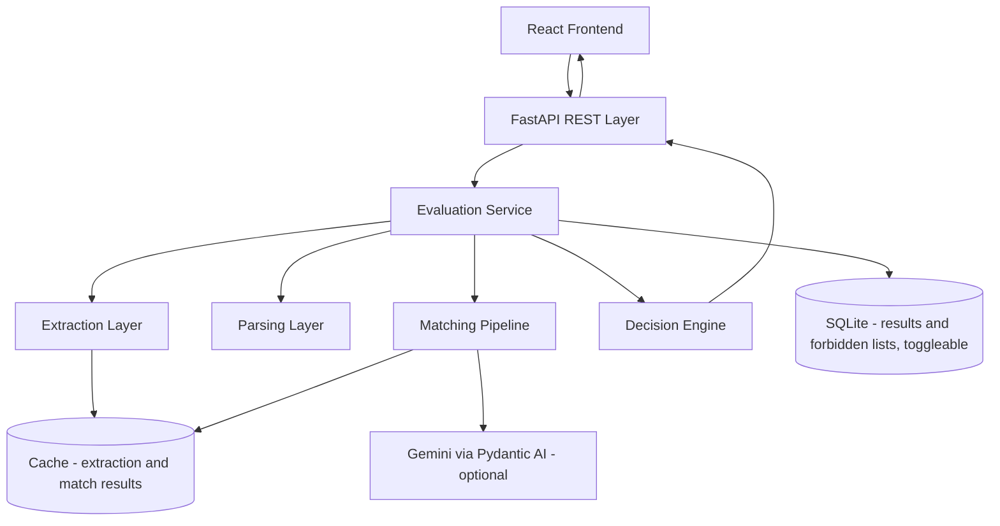
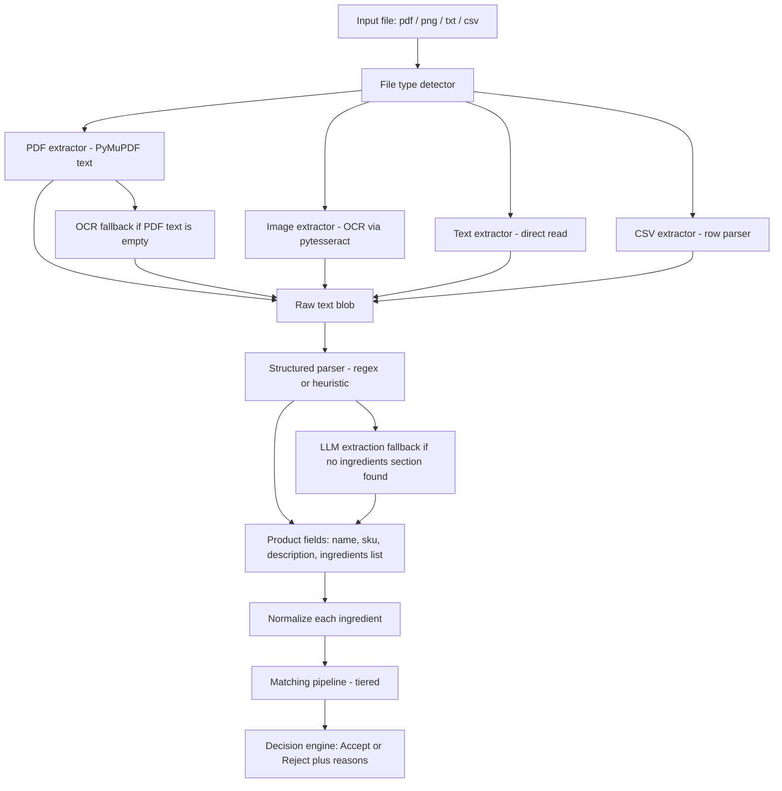
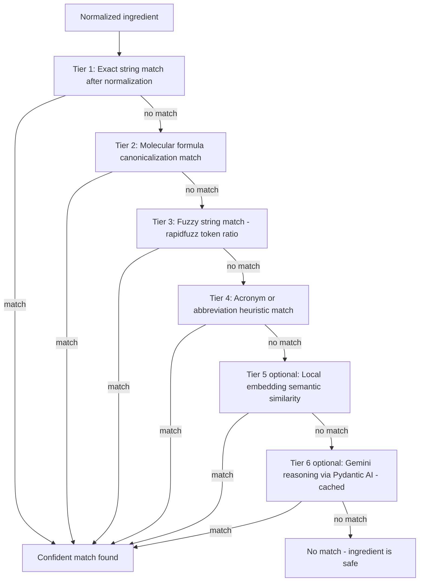
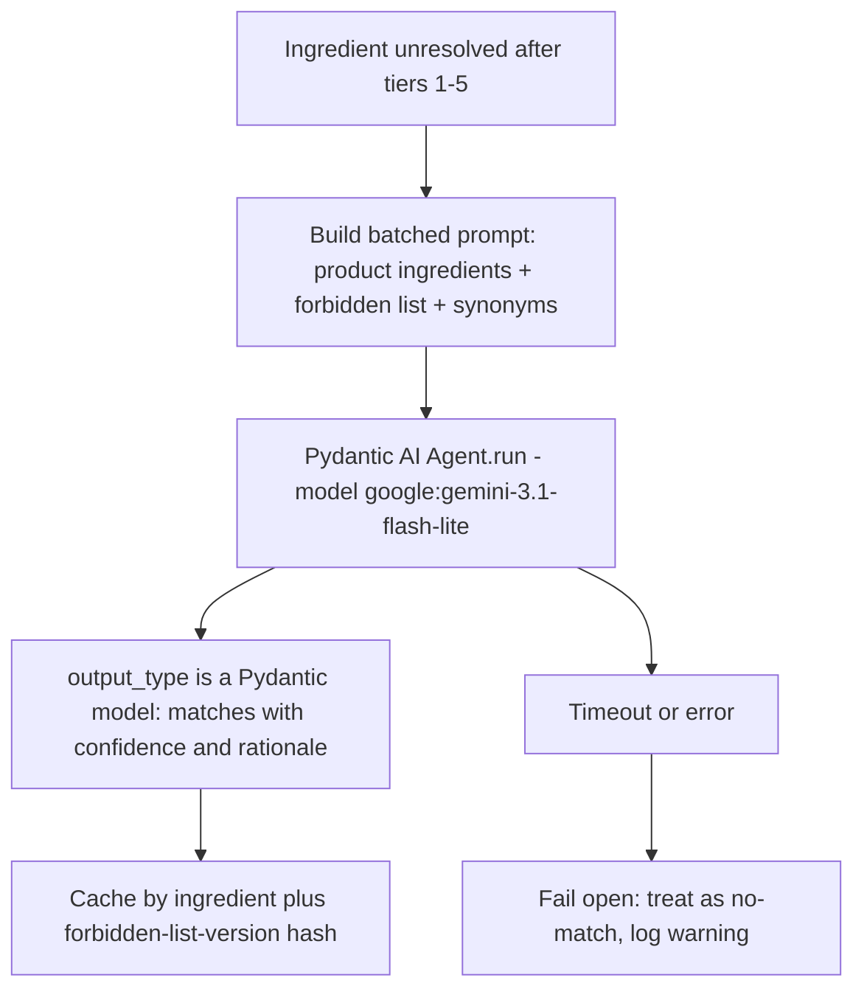

# Architecture & Planning: Product Safety Compliance AI System

> Status: **Draft for iteration**, not yet implemented. This document captures the system design decisions before writing code.

## 1. Problem Restatement

Given product data arriving as PDFs, images, text files, or CSVs, extract the ingredient list and determine whether the product should be **Accepted** or **Rejected** based on the presence of forbidden chemical ingredients, matching against a *customizable* (not hardcoded) forbidden ingredient list, and accounting for naming variations (INCI names, chemical formulas, abbreviations, synonyms). Exposed via a REST API (FastAPI), with an optional React UI.

## 2. Ground Truth From the Provided Dataset

The actual repository layout differs from the challenge `README.md`'s described structure (`data/samples/`, `data/README_data.md`). The real assets are flat at the project root:

```
images/                 # 10 PNG product labels
pdfs/                   # 10 PDF product labels
texts/                  # 10 TXT product labels
product_index.csv       # product_id -> relative file path
forbidden_ingredients.csv  # single-column forbidden ingredient list
README.txt              # brief notes on the synthetic dataset
```

Observations from inspecting samples:

- All product files share one template: `Product ID`, `Product Name`, `SKU`, `Description`, and an `Ingredients / Chemical Formulas:` bulleted section.
- Ingredient entries **mix INCI/common names and raw chemical formulas** in the same list (e.g. `Sodium Hydroxide`, `C6H6`, `H2O2`, `Coumarin`, `Propylparaben`).
- `forbidden_ingredients.csv` similarly mixes formulas (`C6H6`, `C8H10N4O2`, `H2O2`) and names (`BHT`, `Triclosan`, `1,4-Dioxane`).
- PDFs and images in the sample set appear to be clean, text-based renders (not scans), but the hidden evaluation set must not be assumed to follow this; OCR fallback is required for robustness.
- Matching must therefore handle: name/name (with synonym/abbreviation variation), name/formula, and formula/formula equivalence.

## 3. Guiding Principles

1. **Deterministic-first, AI-assisted fallback.** Cheap rule-based matching (exact/formula/fuzzy/acronym) resolves the majority of cases for free and instantly. AI (local embeddings or LLM) only runs on the ingredients that survive all cheap tiers unmatched. The system must remain fully functional with zero API keys present.
2. **Ports & adapters.** Core domain logic (extraction, parsing, matching, decisioning) is framework-free, has no FastAPI/DB/LLM imports, and is independently unit-testable. FastAPI routes, the database, and the LLM client are adapters injected into services.
3. **Explainability.** Every rejection reason must be traceable to which ingredient matched which forbidden entry via which method (exact / formula / fuzzy / acronym / embedding / llm), plus a confidence score.
4. **Generalization over memorization.** No matching logic may be hardcoded to the 13 sample forbidden ingredients or the 30 sample products. The held-out evaluation set is the real test.
5. **Custom forbidden lists.** The forbidden ingredient list is always loaded from a data source (default CSV, replaceable via API upload); never hardcoded in application code.

## 4. High-Level Architecture



## 5. Ingestion to Decision Pipeline



## 6. The Matching Pipeline (Core of the Design)

Each normalized product ingredient is checked against the forbidden list through escalating tiers, stopping at the first confident match. Expensive tiers only ever see ingredients that survived all cheaper tiers unmatched.



**Why each tier exists:**

| Tier | Technique | Catches | Cost |
|---|---|---|---|
| 1 | Normalized exact match (lowercase, strip punctuation/whitespace) | Case/punctuation/whitespace differences | ~0ms |
| 2 | Formula canonicalization (parse `C6H6`/`H2O2` into a sorted element:count dict, order-independent) | Formula written in different element order | ~0ms |
| 3 | `rapidfuzz` token/partial ratio | Typos, plural/singular, shared stems (e.g. `Glucose` vs `D-Glucopyranose` share enough substring overlap to likely be caught here) | ~1ms |
| 4 | Acronym heuristic: compute initials of each multi-word forbidden ingredient name, compare against short all-caps ingredient tokens | `BHA` vs `Butylated Hydroxyanisole`, a generic algorithm, not a hardcoded lookup table | ~1ms |
| 5 (optional) | Local sentence-embedding similarity (`sentence-transformers`, fully offline, no network) | Loose semantic/trade-name variants with no lexical overlap | ~10-50ms |
| 6 (optional) | Gemini reasoning pass via Pydantic AI, batched per product, cached, feature-flagged | Genuine chemistry knowledge: INCI to CAS to trade name equivalence no local heuristic can generalize to | ~200ms-1s, costs credits, needs API key |

Tiers 5-6 are feature-flagged and optional. The system must be fully functional and testable using only tiers 1-4, since an LLM API key cannot be assumed present in the grading environment.

## 7. LLM Provider Abstraction

### Decision: Pydantic AI + Gemini (not LiteLLM, not the Vercel AI SDK)

**Vercel AI SDK** is a TypeScript/Node.js toolkit built around streaming chat UIs and Vercel's AI Gateway, not directly usable from a Python backend. Its new Python port (`vercel-labs/ai-python`) is still an early-stage beta and has no documented direct Gemini provider outside Vercel's gateway.

**LiteLLM** is a mature, Python-native unified interface across 100+ providers with simple Gemini support, and was our original pick. However, on March 24, 2026, LiteLLM suffered a serious supply chain attack: the threat actor "TeamPCP" stole its PyPI publishing credentials via a compromised Trivy CI/CD scanner and published two malicious releases (`1.82.7`, `1.82.8`). The payload harvested credentials (including `.env` files holding LLM API keys), included a Kubernetes lateral-movement toolkit, and installed a persistent backdoor. With roughly 95-97M monthly downloads, LiteLLM was a uniquely high-value target, a concrete illustration of the risk of depending on a mega-package that aggregates 100+ provider integrations into a single trust boundary.

**Decision: use Pydantic AI**, wrapped behind our own thin `LLMClient` interface in `infra/llm/`. It avoids the supply-chain exposure above, wraps Google's official `google-genai` SDK directly (a much thinner dependency surface than a 100+ provider proxy), gives native validated structured output via `output_type` (fitting our "return a structured list of matches" use case better than a raw completion call), and is maintained by the Pydantic org, whose `pydantic` package is already a trusted core dependency of our FastAPI stack. The adapter pattern means we can swap providers again later without touching domain/matching code, if needed.

### Configuration

```
ENABLE_LLM_MATCHING=true
LLM_PROVIDER=pydantic_ai
LLM_MODEL=google:gemini-3.1-flash-lite
GOOGLE_API_KEY=...
```

`LLM_MODEL` is never hardcoded into application logic, always read from settings, so switching models/providers later is a config change only.

### Tier 6 request flow



Batching per-product (rather than per-ingredient) keeps the number of Gemini calls low: one call carries all of a product's unresolved ingredients plus the active forbidden list, and returns a structured, validated list of matches via `output_type`. Results are cached by `(normalized_ingredient, forbidden_list_version)` so reruns and repeated evaluations don't re-spend credits. Failures fail open to "no match" rather than blocking or erroring the evaluation request. An LLM outage must never take down the API.

## 8. Persistence (Toggleable)

Evaluation history and forbidden-list versions are persisted in **SQLite via SQLModel**, gated by a single flag:

```
ENABLE_PERSISTENCE=true
DATABASE_URL=sqlite:///./data/app.db
```

Implemented as a repository interface (`EvaluationRepository`) with two implementations selected once at startup via dependency injection:

- `SqliteEvaluationRepository`: writes evaluation results and forbidden-list versions to SQLite; backs the `GET /api/products` history endpoint.
- `NoopEvaluationRepository`: no-op; the system runs fully stateless (recomputing everything per request, no history endpoint data).

Flipping `ENABLE_PERSISTENCE` never requires touching service or route code; only the DI wiring at startup changes which implementation is bound.

## 9. Repository Layout

```
backend/
  app/
    main.py                 # FastAPI app factory
    core/                    # settings (pydantic-settings), logging, exceptions
    api/                     # routers + pydantic request/response schemas (no version prefix; see Section 10)
    domain/                  # framework-free core logic
      extraction/            # pdf/image/text/csv extractors + file type detector
      parsing/                # structured field/ingredient parser + LLM extraction fallback
      normalization/          # text normalizer + molecular formula parser
      matching/               # tiered matcher pipeline (protocol + implementations)
      decision/               # accept/reject decision engine
      forbidden_list/         # repository abstraction (CSV-backed, versioned)
    infra/
      db/                     # SQLModel models + session (SQLite, toggleable)
      cache/                  # extraction cache + LLM/embedding response cache
      llm/                    # LLMClient interface + Pydantic AI/Gemini adapter
    services/                 # orchestrates domain + infra per use case
  tests/
    unit/ integration/ fixtures/
  pyproject.toml (or requirements.txt), Dockerfile, .env.example

frontend/
  src/
    api/            # typed API client + TanStack Query hooks
    pages/          # Evaluate, Results, ForbiddenList
    components/
  package.json, vite.config.ts

docs/
  ARCHITECTURE.md   # this document
```

## 10. API Design

Response contract preserves the exact shape from the challenge README, with additive fields for transparency. Routes are mounted directly under `/api` with no version segment, kept simple since this is a single-purpose service rather than a long-lived multi-client API; a version prefix can be reintroduced later if it's ever needed. Interactive Swagger UI is served at `/docs` (ReDoc at `/redoc`, raw schema at `/openapi.json`).

```json
{
  "product_name": "Pure Lotion",
  "status": "Rejected",
  "reason": ["Contains Coumarin", "Contains Propylparaben"],
  "matches": [
    {"forbidden_ingredient": "Coumarin", "matched_text": "Coumarin", "method": "exact", "confidence": 1.0}
  ]
}
```

| Endpoint | Purpose |
|---|---|
| `POST /api/evaluate` | Upload one file (multipart), returns evaluation JSON |
| `POST /api/evaluate/batch` | Upload/reference multiple files, processed concurrently with bounded parallelism |
| `POST /api/evaluate/by-path` | Evaluate a file already on disk (useful for `product_index.csv`-style batch runs) |
| `POST /api/evaluate/batch-samples` | First-class endpoint that reads `product_index.csv` and evaluates every mapped product file in one call |
| `GET /api/products` | Paginated evaluation history (only populated when `ENABLE_PERSISTENCE=true`) |
| `GET /api/forbidden-ingredients` | Fetch the active forbidden list |
| `POST /api/forbidden-ingredients` | Replace/upload a custom forbidden list (CSV); never hardcoded |
| `GET /api/health` | Liveness/readiness probe |

## 11. Tooling Choices

| Concern | Choice | Rationale |
|---|---|---|
| API framework | FastAPI + Pydantic v2 | Async-native, typed, free OpenAPI docs |
| PDF text extraction | PyMuPDF (`fitz`) | Fast; can also rasterize pages for OCR fallback if a PDF turns out to be scan-based |
| OCR | `pytesseract` + Pillow | Chosen over EasyOCR for the venv-first phase: sample images are clean rendered text labels, exactly what Tesseract excels at, with no PyTorch model-weight downloads. Requires one documented system-binary install step (`brew install tesseract` / `apt-get install tesseract-ocr`); revisit EasyOCR if messier real-world photos become a requirement, or once Docker (which can bundle the binary) is introduced |
| Fuzzy matching | `rapidfuzz` | C-accelerated Levenshtein/token ratios, no heavy dependency footprint |
| Embeddings (optional tier) | `sentence-transformers` (MiniLM) | Fully offline semantic generalization, no network/API cost |
| LLM provider abstraction | Pydantic AI, model `google:gemini-3.1-flash-lite` | Native Gemini support via Google's official `google-genai` SDK, validated structured output via `output_type`, maintained by the Pydantic org (already a trusted core dependency). Chosen over LiteLLM specifically due to LiteLLM's March 2026 supply chain compromise (see Section 7) |
| Database | SQLite via SQLModel, toggleable via `ENABLE_PERSISTENCE` | Zero external infra to stand up; swapping to Postgres later is a connection-string change |
| Cache | `diskcache` or a dedicated SQLite table | Persists extraction + LLM/embedding results across restarts, avoids recomputation and repeat Gemini spend |
| Lint/format | Ruff | Single fast tool covering both linting and formatting |
| Testing | pytest + FastAPI `TestClient` | Standard, well-integrated |
| Frontend | Vite + React + TypeScript + TanStack Query + Tailwind CSS | Lean, fast dev loop, no heavyweight framework overhead |
| Env management | Python venv + `requirements.txt` | Matches the README's explicit expectation and keeps setup friction low |

## 12. Performance & Robustness Notes

- Blocking work (OCR, PDF parsing) runs via FastAPI's threadpool so the event loop is never blocked; the batch endpoint uses a bounded `asyncio.Semaphore` to cap concurrency.
- Extraction results are cached by file content hash; a given file is never OCR'd/parsed twice.
- LLM/embedding match results are cached by `(normalized_ingredient, forbidden_list_version)`, avoiding repeat cost and keeping results stable across reruns.
- Per-file error isolation in batch mode: one corrupt/unsupported file must not fail the entire batch.
- Gemini calls carry timeouts and fail open to the rule-based result rather than erroring the whole request. The system must degrade gracefully, not catastrophically, when the LLM tier is unavailable or slow.
- Heavy models (embedding model, OCR engine) are loaded once at app startup (FastAPI lifespan), not per-request.

## 13. Testing Strategy

- Unit tests per extractor, run against the 30 provided sample files, with manually verified expected ingredient sets as fixtures.
- Unit tests for the formula parser: order-independence, malformed input handling.
- Unit tests for each matcher tier in isolation, including a synthetic case for the README's `Glucose` vs `D-Glucopyranose` example.
- Integration tests hitting `POST /evaluate` end-to-end for all 30 sample files.
- API contract test asserting the response shape matches the challenge README's exact example schema.
- Edge cases: empty ingredient list, unsupported/corrupt file type, malformed forbidden-list CSV upload, no discoverable "Ingredients" section (exercises the LLM/heuristic extraction fallback path).
- LLM matcher tier tested with a mocked `LLMClient` so the test suite never depends on network access or real Gemini credits.

## 14. Phased Implementation Plan

1. **Scaffolding**: venv, FastAPI skeleton, settings, health check, Ruff config, repo structure.
2. **Extraction layer**: implement all 4 format extractors + file-type detector; test against all 30 sample files.
3. **Normalization & matching**: text normalizer, formula parser, tiers 1-4, decision engine, forbidden-list repository (CSV-backed, replaceable).
4. **API layer**: evaluate / batch / by-path / batch-samples endpoints, forbidden-list endpoints, error handling, OpenAPI docs.
5. **Optional AI tiers**: embedding matcher (tier 5) and Pydantic AI/Gemini matcher (tier 6), response caching, feature flags.
6. **Frontend**: upload/evaluate flow, results table with status badges and match explanations, forbidden-list management page.
7. **Docs & polish**: setup guide, Dockerfile, full 30-sample validation run, Loom video talking points.

## 15. Finalized Decisions Log

| # | Question | Decision |
|---|---|---|
| 1 | LLM fallback provider | Pydantic AI (provider abstraction) + Gemini `
gemini-3.1-flash-lite`, chosen over LiteLLM due to its March 2026 supply chain attack (see Section 7) |
| 2 | Persistence | SQLite via SQLModel, toggleable via `ENABLE_PERSISTENCE` flag (see Section 8) |
| 3 | OCR engine (venv-first phase) | Tesseract + `pytesseract`; revisit EasyOCR once Docker is introduced |
| 4 | Batch "evaluate all samples" | First-class API endpoint (`POST /api/evaluate/batch-samples`), reads `product_index.csv` |
| 5 | Target versions | Python 3.11, Node 20+ |
